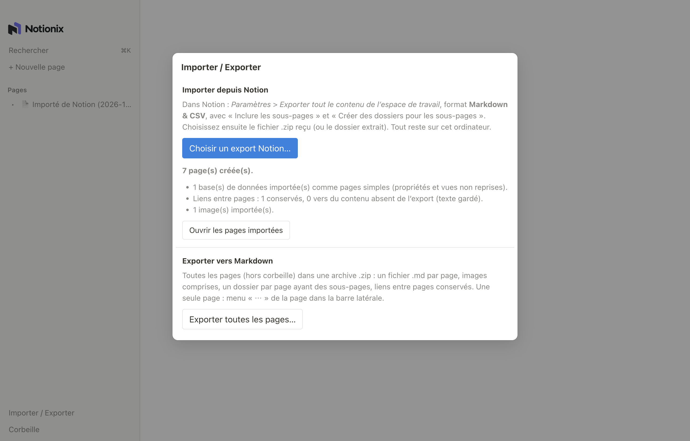
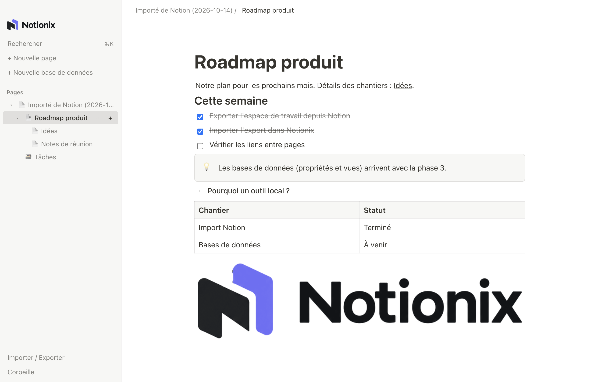
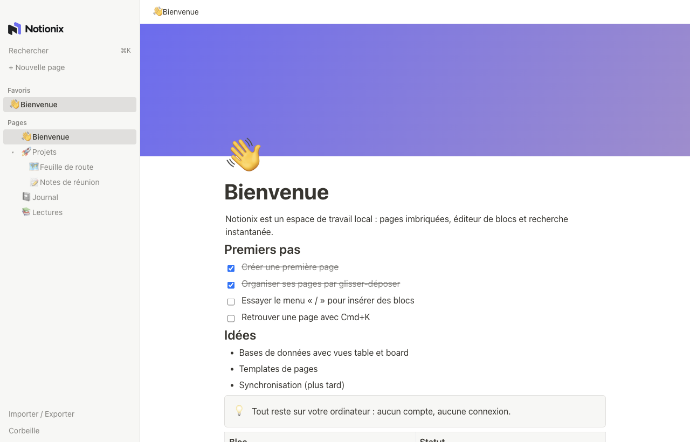
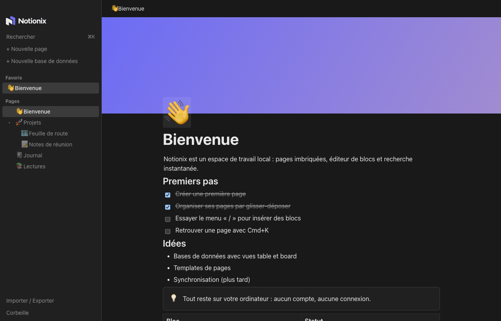
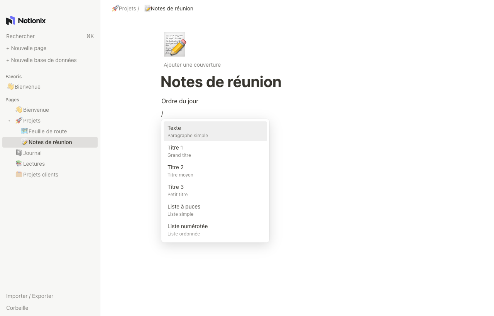
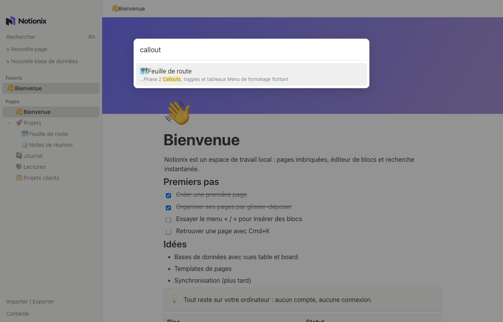
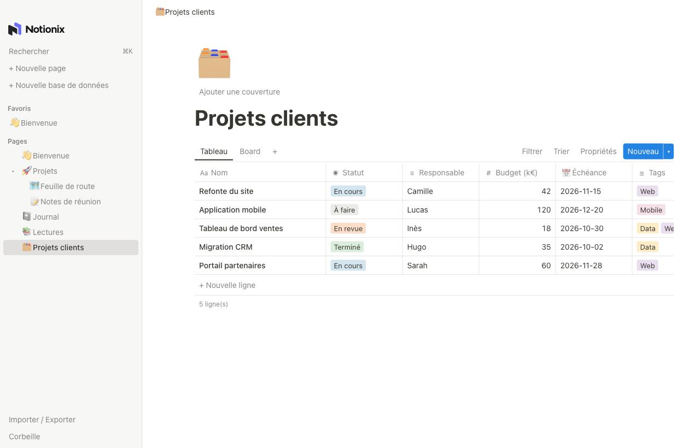
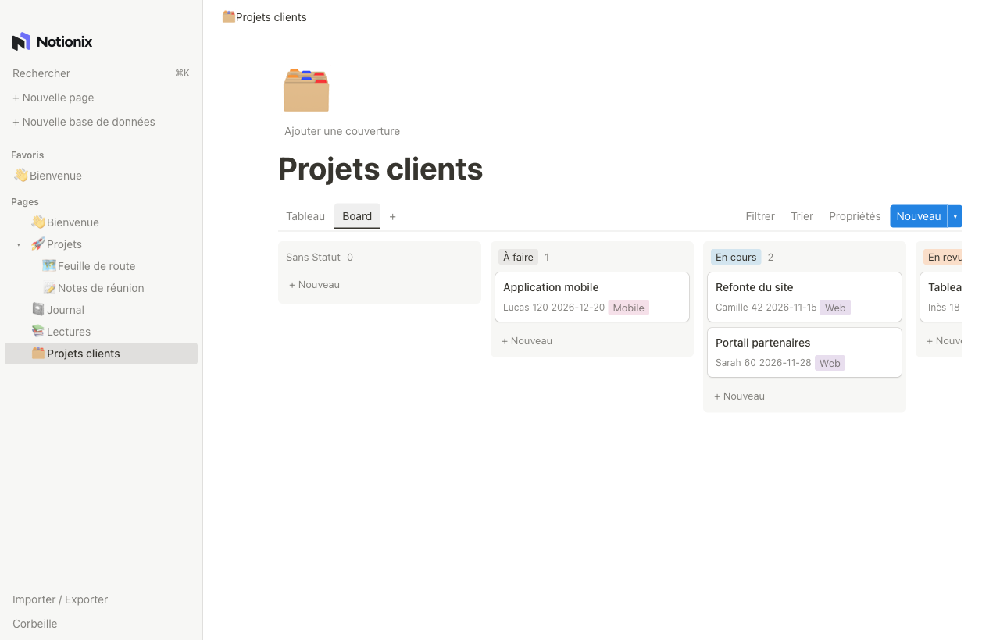

<p align="center">
  <picture>
    <source media="(prefers-color-scheme: dark)" srcset="docs/brand/notionix-dark.png">
    
  </picture>
</p>

<p align="center"><strong>Un espace de travail à la Notion, local ou partagé sur votre réseau.<br>Vos pages restent chez vous, et vous pouvez y migrer votre Notion en quelques clics.</strong></p>

Notionix est une réimplémentation originale (aucun code ni asset Notion) : pages imbriquées, éditeur de blocs, recherche instantanée, et surtout **un import direct de vos exports Notion** et un export Markdown pour repartir quand vous voulez. Deux façons de l'utiliser : **l'app de bureau**, 100 % locale, ou **le serveur Notionix** pour travailler à plusieurs depuis un navigateur, en temps réel, sur votre réseau.

## Points forts

- **Importez votre Notion** : un export « Markdown & CSV » (`.zip` ou dossier) devient des pages Notionix, hiérarchie et liens entre pages compris. Réimport sans doublon, sans jamais écraser vos modifications.
- **Bases de données** : propriétés typées (texte, nombre, sélection, multi-sélection, **statut**, date, case à cocher, URL, e-mail, téléphone, **personne**, **fichiers**, relation **à double sens**, **formule**, **rollup**, identifiant unique, créé/modifié par et quand), vues tableau, board, liste, galerie, calendrier, **chronologie**, **graphique** et **formulaire**, **vues liées** dans les pages, filtres, tris, groupes, **sous-éléments** et **dépendances**, ordre manuel des lignes, modèles de lignes.
- **Travail d'équipe** : **plusieurs espaces de travail** par serveur, pages privées, partage page par page (lecture, commentaire, modification, accès complet) avec des personnes ou des **groupes**, espaces d'équipe, invités, **commentaires** et **mentions @**, **boîte de réception** (mentions, réponses, partages, rappels), fil d'activité, **historique des versions**, présence des autres sur la page, **publication sur le web**.
- **Importez d'autres outils** : Word (.docx, Google Docs téléchargé en Word), HTML, Markdown, texte, Evernote (.enex, cases à cocher et images comprises), Confluence (export HTML de l'espace, arborescence reconstruite) et Google Docs en page web zippée.
- **Exportez quand vous voulez** : tout (ou une page et ses sous-pages) en Markdown dans l'organisation d'un export Notion, en HTML, ou une page en PDF.
- **Local d'abord** : l'app de bureau n'a besoin d'aucun compte ni d'aucune connexion ; tout est dans une base SQLite sur votre machine.
- **À plusieurs, chez vous** : le serveur Notionix (un conteneur Docker) sert l'application dans le navigateur, avec comptes, rôles et édition simultanée d'une même page (curseurs des autres visibles).
- **Éditeur de blocs** : titres, listes, tâches, citations, code coloré, tableaux, **colonnes**, images, **fichiers, vidéos et audios**, callouts, toggles et **titres repliables**, équations LaTeX, **table des matières**, **liens vers une page**, **blocs synchronisés**, **boutons**, **couleurs** de texte, de fond et de bloc, mentions de personnes, de pages et de dates avec **rappels** ; menu `/`, menu de mise en forme, menu de bloc (transformer en, couleur, dupliquer), icônes, couvertures, options de page (pleine largeur, petit texte, police, verrouillage).
- **Modèles** prêts à l'emploi (réunion, projet, wiki, journal, suivi de bugs, liste de lecture) et pages enregistrées comme modèles.
- **Retrouvez tout** : recherche plein texte instantanée (`Cmd/Ctrl+K` ou `P`) avec filtres (titres seulement, auteur, sous-arbre, date de modification, type), pages récentes, rétroliens, favoris, corbeille vidée après 30 jours, **statistiques de vues** par page.
- **Feedback** : chacun signale un bug ou propose une idée depuis l'app (capture d'écran et contexte joints) ; les administrateurs les suivent, changent leur statut et répondent, l'auteur est prévenu.
- **API** pour vos scripts, avec des jetons personnels ([docs/api.md](docs/api.md)).
- **Thème clair et sombre** selon le système.

## Migrer depuis Notion

1. Dans Notion : _Paramètres > Exporter tout le contenu de l'espace de travail_, format **Markdown & CSV**, en cochant « Inclure les sous-pages » et « Créer des dossiers pour les sous-pages ».
2. Dans Notionix : _Importer / Exporter > Choisir un export Notion…_, puis le `.zip` reçu (ou le dossier extrait ; les exports découpés en plusieurs archives sont gérés).
3. Ouvrez « Importé de Notion » : vos pages sont là, avec leurs sous-pages et leurs liens.

| L'import                                                                          | Le résultat                                                                                              |
| --------------------------------------------------------------------------------- | -------------------------------------------------------------------------------------------------------- |
|  |  |

**Ce qui est repris**

- Hiérarchie reconstruite depuis les dossiers (`Page <id>.md` + dossier `Page <id>/`), sous une page « Importé de Notion (date) ».
- Titres, paragraphes, gras/italique/barré/souligné/code, listes imbriquées, tâches, citations, blocs de code, séparateurs, **tableaux** (y compris ceux que Notion casse sur plusieurs lignes), **images** (copiées dans Notionix), **callouts** avec leur icône, **toggles**, **équations** en ligne et en bloc.
- Liens entre pages, cliquables dans l'éditeur (liens `notion.so` vers une page de l'export inclus). Les schémas non sûrs (`javascript:`…) sont retirés.
- **Bases de données** : chaque CSV devient une vraie base ; le type de chaque colonne est déduit de toutes ses valeurs (case à cocher, nombre, date et plage, URL, e-mail, sélection, multi-sélection, sinon texte) ; chaque ligne retrouve sa page et son contenu, dans l'ordre de la vue Notion ; les **modèles** de base (pages sans ligne dans le CSV) redeviennent des modèles ; les **relations** entre bases sont reconstruites (liens « Titre (page) » ou titres) ; une base affichée dans une page reste **affichée dans la page** (bloc base de données inline).
- **Réimport sans doublon** : l'identifiant Notion est mémorisé ; une page déjà importée n'est jamais écrasée, seules les nouvelles pages sont ajoutées à leur parent.
- Un **rapport d'import** détaille à l'écran ce qui n'a pas pu être repris.

**Ce qui ne l'est pas encore** : pièces jointes autres que des images (PDF…), images distantes (gardées en lien, rien n'est téléchargé), ce que l'export Notion ne contient pas : vues (filtres, tris, regroupements ; un board est proposé s'il y a une sélection), couleurs des options, formules et rollups (leur valeur arrive figée), personnes (en texte), icônes et couvertures (absentes de l'export Markdown de Notion).

> Validé sur de vrais exports Notion (espace de 85 pages et 10 bases, dates en français, multi-sélections, bases dans les pages, images, tâches, callouts, équations). Pas encore confronté à un vrai export avec relations entre bases, colonnes nombre ou case à cocher, ni toggles : la lecture de ces cas suit le format connu de Notion. `npm run build && node scripts/import-check.mjs export.zip` importe un export dans un profil jetable et affiche le rapport, l'arborescence et les schémas déduits.

**Dans l'autre sens.** « Exporter toutes les pages… » (archive `.zip`) ou « ⋯ > Exporter en Markdown » sur une page (sous-pages incluses) : un fichier `.md` par page, un dossier par page ayant des sous-pages, liens entre pages relatifs. Les bases sont exportées en CSV au format Notion, leurs lignes en pages. Notion sait réimporter ce format (_Importer > Texte & Markdown_, _CSV_). L'import par l'API Notion (jeton d'intégration) pourra venir avec la phase en ligne.

## Travailler à plusieurs (serveur Notionix)

Le serveur tourne sur une machine du réseau ; chacun ouvre `http://<adresse-du-serveur>:8080` dans son navigateur et se connecte avec son compte.

```
docker compose -f server/docker-compose.yml up -d --build
```

- Même application que sur le bureau (pages, bases de données, images, import Notion par envoi du `.zip`, export Markdown téléchargé), sur un espace partagé.
- Édition simultanée : le contenu de chaque page est un document Yjs partagé (Hocuspocus) ; titres, arborescence et bases se mettent à jour chez tout le monde.
- Comptes gérés dans l'app (bouton « Administration » pour l'administrateur, « Mon compte » pour son mot de passe et ses jetons d'API). À la création, une **clé de connexion à partager via Keeper** (lien d'activation à usage unique, valable 7 jours, où la personne choisit son mot de passe ; ou mot de passe provisoire à changer à la première connexion), présentée comme les champs d'un enregistrement Keeper ; la même chose sert en cas d'oubli. Départ d'une personne : ses pages privées sont confiées à quelqu'un d'autre, puis le compte désactivé. **Tableau de bord** : comptes, personnes connectées, sessions (déconnexion à distance), taille des données par espace, retours à traiter, **journal d'audit** (connexions, comptes, partages, publications, suppressions, imports et exports, conservé un an). Espaces archivables et supprimables (fichiers mis de côté dans `deleted-workspaces/`). Rôles : `admin`, `editor`, `reader` (lecture et commentaires), `guest` (seulement les pages partagées avec lui). Session par cookie `HttpOnly` ; les changements exigent un en-tête propre au client (protection CSRF).
- Droits vérifiés par le serveur sur chaque opération, recherche, export et connexion temps réel : page de l'espace, privée (son créateur) ou restreinte aux personnes invitées, droits hérités par les sous-pages.
- Plusieurs espaces de travail (onglet « Espaces de travail » des paramètres administrateur, sélecteur en haut de la barre latérale) : l'espace principal est ouvert à tous les comptes, les autres à leurs membres et aux administrateurs ; la boîte de réception réunit les notifications de tous ses espaces, et un lien vers une page d'un autre espace y bascule directement ; groupes de personnes (onglet « Groupes ») choisis dans le menu Partager.
- Données dans un volume : `workspace.db` et `assets/` (espace principal, même format que la base de l'app de bureau), `workspaces/<id>/` (autres espaces), `notionix-server.db` (comptes, groupes, liste des espaces, documents partagés).

HTTPS intégré : profil `https` du docker-compose (relais Caddy, autorité interne ou certificat de l'entreprise). Mise à jour du serveur après des modifications poussées sur GitHub : `sh server/update.sh` (données et comptes conservés). Installation, comptes, sauvegardes et passage en HTTPS derrière IIS : [docs/deploy/README.md](docs/deploy/README.md). Développement : `npm run server` (construit et lance sur le port 8080), `npm run dev:web` (client web avec rechargement, relayé vers ce serveur).

## Aperçu

| Thème clair                                                           | Thème sombre                                                       |
| --------------------------------------------------------------------- | ------------------------------------------------------------------ |
|             |          |
|  |       |
|   |  |

Captures régénérées par `npm run build && node scripts/screenshots.mjs` (profils temporaires et export Notion de démonstration : rien n'est lu dans vos données).

## Stack

Electron 39, React 19, TypeScript, TipTap 3 (ProseMirror), Zustand, SQLite via `node:sqlite` (FTS5, aucune dépendance native à recompiler), Vitest, Playwright (smoke e2e). Serveur : Node 22, Hocuspocus 4 + Yjs, un seul fichier JavaScript (esbuild) et le client web (Vite) dans une image Docker.

## Lancer

```
nvm use          # Node 24.18.0 (Electron 39 embarque Node 22)
npm install
npm run dev      # développement
npm test         # tests unitaires (repository SQLite)
npm run test:e2e # build + tests e2e Electron, puis la version web contre un vrai serveur (test:e2e:web)
npm run typecheck && npm run lint
npm run server   # serveur + client web sur http://localhost:8080
```

## État actuel (phases 1 à 3, import/export Notion, serveur collaboratif et fonctions d'équipe terminés)

- Pages imbriquées, arbre en sidebar, glisser-déposer pour réordonner ou imbriquer, favoris, duplication (sous-pages incluses), fil d'Ariane.
- Corbeille : sous-arbre mis à la corbeille ensemble, restauration, suppression définitive.
- Éditeur de blocs (TipTap) : titres, listes à puces/numérotées/tâches, citation, code avec coloration, séparateur, liens, tableaux (lignes/colonnes, en-tête, redimensionnement), images (fichier, coller, glisser ; stockage local par empreinte SHA-256 servi par le protocole `notionix-asset://`), callouts à icône, toggles, équations LaTeX en ligne et en bloc (KaTeX, édition avec aperçu) ; menu `/`, menu flottant de mise en forme et de tableau, poignée de déplacement des blocs.
- Recherche plein texte (titre + corps) via `Cmd/Ctrl+K`.
- Sauvegarde automatique (debounce 400 ms), thème clair/sombre selon le système.
- Icônes de pages (emoji) et couvertures (dégradés ou image locale), affichées aussi dans la barre latérale et le fil d'Ariane.
- Bases de données (page de type base) : schéma de propriétés typées, valeurs validées à chaque écriture, vues tableau/board/liste/galerie/calendrier en onglets, filtres (et/ou) et tris par vue, changement de type avec conversion des valeurs, options colorées, relations vers une autre base, modèles de lignes, recherche dans les valeurs. Les lignes s'ouvrent comme des pages avec leurs propriétés sous le titre.
- Formules (langage proche de Notion : `prop("Prix") * 1.2`, `if`, texte, nombres, dates ; aide et validation dans l'éditeur) et rollups (somme, moyenne, médiane, min/max, comptes, pourcentages, dates extrêmes, valeurs) calculés à la lecture, jamais stockés, références circulaires signalées. Groupes par sélection ou case à cocher dans les vues tableau, liste et board ; ordre manuel des lignes par glisser-déposer quand la vue n'est pas triée (changer de groupe change la valeur).
- Import d'un export Notion (Markdown & CSV) et export Markdown, voir « Migrer depuis Notion ».
- Données : `pages(id, parent_id, position, version, updated_at…)`, `version` incrémentée à chaque écriture.
- Serveur Notionix (phase de test sur réseau local) : client web servi par le serveur, comptes et rôles, édition simultanée des pages (Yjs, curseurs), mise à jour en direct de l'arborescence, des titres et des bases, images partagées, import Notion et export Markdown, image Docker validée (API, recherche, sauvegarde à chaud).
- Équipe : droits par page et partages, espaces d'équipe, invités, historique des versions (états regroupés par tranche de 10 minutes, 100 par page, restauration y compris dans les documents partagés), commentaires sur une sélection ou la page, mentions @ (personnes, pages, dates), notifications et activité, rappels (notification système dans l'app de bureau), présence, publication web en lecture seule.
- Éditeur : colonnes, couleurs, menu de bloc, fichiers/vidéos/audios, table des matières, liens vers une page, blocs synchronisés (contenu dans une page cachée), boutons, titres repliables, options de page.
- Bases (lot « bases de données ») : formules 2.0 (écriture à points `prop("Tâches").filter(current.prop("Fait")).length()`, pages liées et personnes comme objets, texte, regex, statistiques, dates), graphiques barres / horizontales / empilées / courbe / aire / anneau / camembert / nombre (médiane, min, max, cumul), base verrouillée (vues et propriétés figées, lignes modifiables), modèles récurrents (tous les jours, jours de la semaine choisis, mois, an, à une heure donnée, date de la ligne renseignée ; exécutés par le serveur ou l'app ouverte).
- Bases : personne, fichiers, statut, créé/modifié par, identifiant unique, relations à double sens, sous-éléments, dépendances, vues chronologie, graphique et formulaire, vues liées, fusion des modifications de structure simultanées.
- Espace : rétroliens, récents, modèles, exports HTML et PDF, API à jetons.
- Espace de travail (partie 3) : icônes de page en image, couverture repositionnable, recherche filtrée, statistiques de vues (28 jours, personnes), groupes de personnes pour le partage, plusieurs espaces par serveur, import Word/HTML/Markdown/texte/Evernote/Confluence/Google Docs (converti dans le client, puis créé comme toute page ; pièces jointes en blocs fichier, liens entre pages importées dans les deux sens grâce aux identifiants réservés à l'avance).

## Identité visuelle

La planche source est `branding/notionix-brand-sheet.png`. `python3 -I scripts/build-logos.py` (Pillow, numpy, `iconutil` sur macOS) en dérive :

- bannière avec nom, transparente, en variantes claire/sombre (sidebar et écran d'accueil, selon le thème système) ;
- tuile blanche (la plus à gauche de la planche) et tuile sombre (deuxième à gauche) : favicon et icône d'application (`build/icon.*`, `resources/icon.png`, icône du Dock en dev), la tuile sombre servant d'icône d'app.

Les logos sont recadrés depuis une image de 1254 px : l'icône 1024 px est un agrandissement, un peu douce. Un export vectoriel du logo permettrait de la régénérer nette.

## TODO

- Valider sur un vrai export les cas encore non rencontrés : relations entre bases, colonnes nombre et case à cocher, toggles.
- Embeds (YouTube…) : reportés, ils supposent du réseau ; à reprendre avec la phase en ligne.
- Serveur : invitations et mot de passe oublié par e-mail (nécessite un serveur SMTP, mis de côté) ; adaptation mobile et installation sur téléphone (PWA, possible maintenant que le HTTPS est en place).
- Hors périmètre décidé : intégrations externes (YouTube…), automatisations, IA.
- App de bureau : se connecter à un serveur Notionix (aujourd'hui seulement locale) et y envoyer ses pages locales.
- Phase 4 : finitions UI (raccourcis, onglets), packaging, import par l'API Notion.

## Limites connues

- Le contenu d'une page est un seul document JSON (côté serveur : un document Yjs par page) : pas de bloc adressable individuellement.
- Serveur : une même cellule modifiée au même moment par deux personnes garde la dernière valeur (comme dans Notion) ; les modifications de structure (propriétés, vues) sont fusionnées. Sans le HTTPS (profil `https` du docker-compose, ou IIS), mots de passe et contenus circulent en clair sur le réseau.
- Export Markdown : les blocs synchronisés sont écrits avec leur contenu, la table des matières en liste des titres, un bouton par son libellé ; les vues liées exportent la base d'origine ; couleurs et colonnes ne survivent pas au Markdown (comme dans l'export de Notion).
- Imports d'autres outils : les mises en forme propres à Word (couleurs, tableaux complexes) suivent ce que l'éditeur sait représenter ; les liens entre notes Evernote (`evernote:///…`) ne sont pas reliés.
- `node:sqlite` est expérimental dans Node 22 (avertissement au lancement).
